2026年10月2日、金曜日。
秋葉原のジャンク屋やイオシスを巡回するのとはまた少し違う、それでいてハードウェアオタクの魂を根底から揺さぶる聖地へと足を運んだ。
場所は東京・渋谷。渋谷駅からも表参道駅からも徒歩圏内にある「VORT渋谷 east II」の3階に居を構える体験型ガジェットショールーム、「&count（エンカウント）」である。

普段、日本の家電量販店のスマホ売り場に足を運んでも、並んでいるのはiPhoneかPixelかGalaxy、あるいは無難なミドルレンジ機ばかりである。あまりパッとしないスマホをを眺めながら、「俺たちが本当に触りたいのはこういうのじゃないんだよなあ！」とため息をつく日々を送っていた。そんな乾ききった日本のモバイル環境に、2026年8月20日、突如として降臨したのがこの&countだ。
今回は、この&countという空間がいかなる場所であるのか、という夢のような時間を記録に残しておこうと思う。

## 「売らないショールーム」&countとは何者か——運営会社と管理人の正体

まず、&countという場所の成り立ちについて整理しておく必要がある。ここを単なる「ちょっと変わったガジェットショップ」と捉えると、その本質を見誤る。&countは店頭での直接販売を一切行わない、完全予約制・入場無料の「売らない体験型ショールーム兼コミュニティ拠点」である。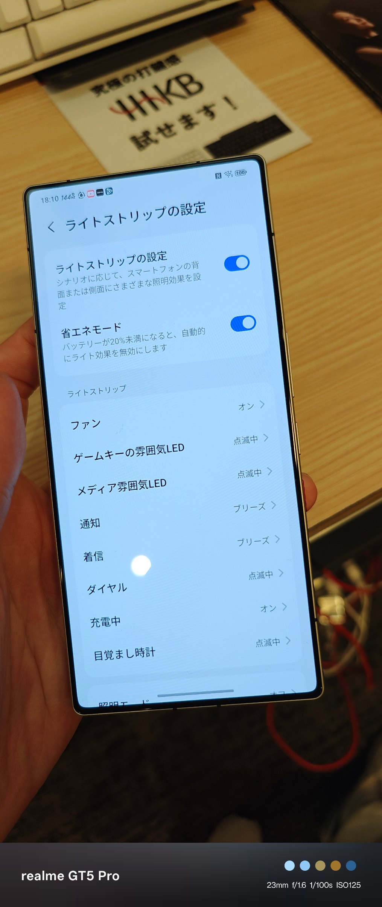
入店すると、端末は誰でも使える完全フリーの状態で置かれている。

この異色のスペースをプロデュース・運営しているのは、**Fastlane Japan株式会社**という企業だ。実は同じビルの8階に本社を構えている。ガジェット好きならピンとくるはずだが、Fastlane Japanはゲーミングスマートフォン「REDMAGIC」や「nubia」の日本国内における正規代理店事業をはじめ、世界中の魅力的なハードウェアメーカーの日本市場参入・展開をワンストップで支援しているコンサルティング企業である。
Fastlane Japanが&countを立ち上げた背景には、日本のガジェット市場が抱える構造的な問題への強い問題意識がある。世界のハードウェア製造の心臓部である中国・深圳だけでも、政府認可の優良テック企業は2万5000社以上にのぼるという。しかし、技適の壁や販路の制約、ローカライズコストといった要因によって、日本の消費者が量販店で実際に手に取れる製品は全体のわずか数％に過ぎない。スペックシートの数字や海外レビュアーのYouTube動画だけでは絶対に伝わらない「質感」「重さ」「ヒンジのトルク感」「ボタンのクリック感」を日本のユーザーに体験してもらい、同時にそのリアルなフィードバックをメーカーの開発現場へ直接届ける
——そんなハブ機能を目指して作られたのが&count。
施設名の「&count」は、RPGで未知のモンスターやアイテムと遭遇する「エンカウント（Encounter）」と、人とテクノロジーが交差する「&（アンド）」を掛け合わせた造語だという。まさに、扉を開けた瞬間に未知のガジェットとエンカウントする感覚そのものである。
そして、この空間の魂とも言える「店長 兼 管理人」を務めている人物が、日本のテックメディア史のレジェンド、\*\*矢崎飛鳥（ACCN）氏、\*\*その人である。
歴任としては

* 週刊アスキーの副編集長
* Engadget 日本版の編集長
* TechnoEdgeの創刊編集長

さらには「スマートフォン」を「スマホ」と略す呼び方を考案・普及させた張本人としても知られる業界の重鎮だ。

店内には無料Wi-Fiや電源が完備されたフリースペースだけでなく、3Dプリンターやレーザー彫刻機まで設置されており、クリエイターやユーザーが集まって語り合い、ものづくりまでできる環境が整っている。エレベーターで3階に上がり、ドアが開いた瞬間に目に飛び込んでくる無機質かつ洗練されたディスプレイ空間は、まるで未来の研究所に迷い込んだかのような高揚感を与えてくれる。

## 狂気のラインナップ！常設展示の最新＆変態端末を片っ端から触り倒す

予約時間に入店し、さっそく展示スペースを見渡すと、そこは完全に「俺得」としか言いようがない空間だった。日本国内で正規展開されている最新ゲーミング機から、一般のショップではまずお目にかかれない変態端末まで、あらゆる機材が完全にフリーな状態で並んでいる。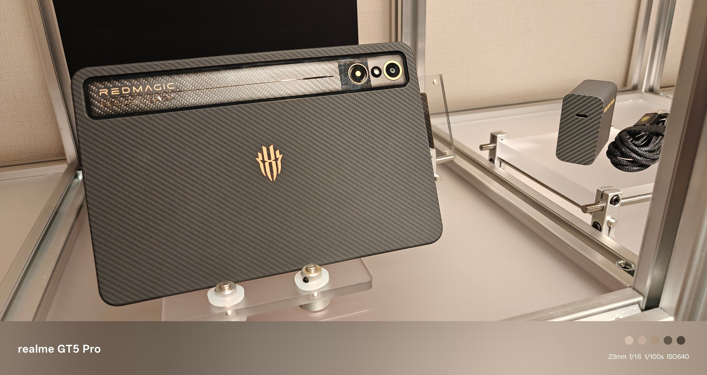普通にしれっと置いてある「RedMagic Astra Golden Saga」

## 1\. REDMAGIC 11 Pro & REDMAGIC 11 Pro\+ 鳴潮コラボモデル

まず真っ先に目を奪われたのが、Fastlane Japanのお膝元とも言えるREDMAGICコーナーである。
ここには現行フラッグシップの「REDMAGIC 11 Pro」をはじめとして、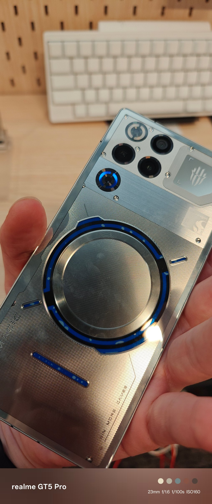これ、モックじゃなくて実機なんだよね。
鳴潮の千咲コラボの限定モデル「REDMAGIC 11 Pro+ 鳴潮 Limited Edition」が鎮座している。
これのオーラがまた凄まじい。中国限定モデルであり、24GB RAM＋1T構成で現地価格9899元（約23万円超）という超高級コレクターズアイテムだが、こうして日本のショールームで実物を拝めるだけでも&countに来た価値があるというものだ。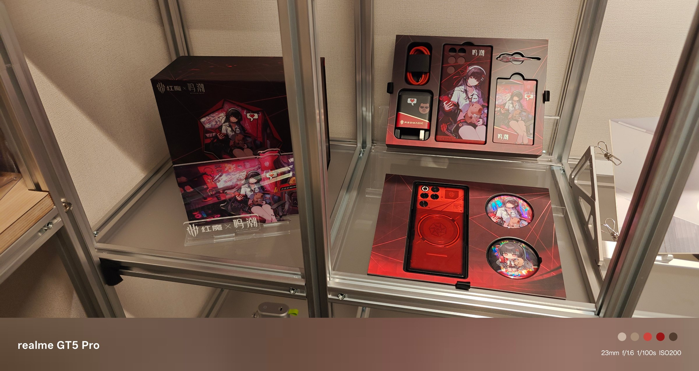付属品の武器型SIMピンや専用アクリルスタンドなどの細部へのこだわりも含め、単なる「コラボ商法」ではなくハードウェアとしての完成度が異常に高い。

## 2\. REDMAGIC Astra 2——9インチ級OLED×水冷搭載の最強ゲーミングタブレット

続いて触ったのが、ゲーミングタブレットの概念を書き換える「REDMAGIC Astra 2」である。この機体の実物を触るのを非常に楽しみにしていた。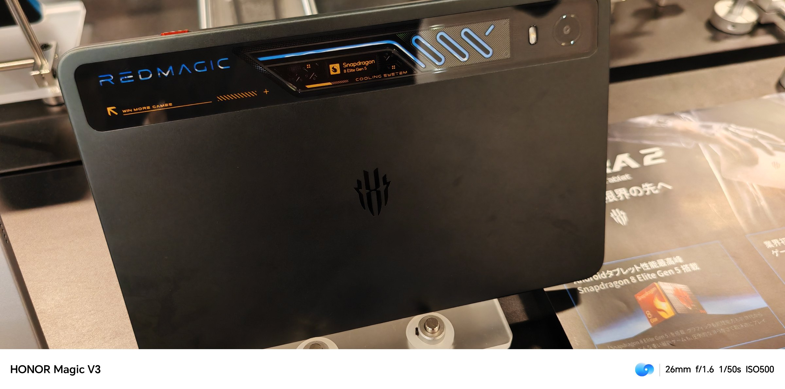
手に持った瞬間の第一印象は「圧倒的な密度感と軽さ」だ。本体サイズは207.1mm × 134.2mm、厚さはわずか6.9mm、重量は約363g。9.06インチという絶妙なサイズ感は、両手で横持ちしたときに親指が画面の中央付近まで無理なく届き、それでいてスマホとは比較にならない情報量と視認性を確保している。
この端末のミソは、**デュアルUSB-Cポート**の配置だ。短辺側（USB 3.2 Gen 2 / DP映像出力対応）と長辺側（USB 2.0）の2箇所にポートが用意されており、横持ちでゲームをプレイしながらケーブルを挿しても、充電ケーブルが絶対に手に干渉しない。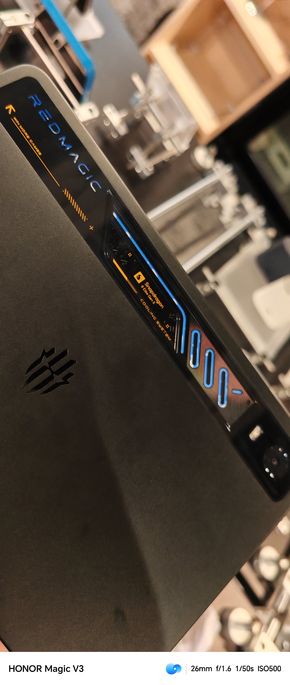写真撮り忘れてて終わった

もちろんゲーミング端末らしく、バッテリーを介さず直接本体に給電する「バイパス充電」にも対応し、8,300mAhの大容量バッテリーを積んでいる。
赤いスライド式の「マジックキー」をカチッと切り替えた瞬間にゲームスペースが起動するギミックも含め、ゲーマーの欲望をすべて具現化したような完成度だった。

#### 3\. Nothing Phone \(3\)——スケルトン美学とミニマリズムの進化

ゲーミング端末の熱気から一転、インダストリアルデザインの極致を見せてくれたのが「Nothing Phone (3)」である。Nothing製品といえばスケルトン（透明）デザインと背面のLEDインターフェース「Glyph」が代名詞だが、実機を間近で観察すると、写真で見る以上に内部パーツのレイヤー構造とネジの配置、マットな質感と光沢パーツのコントラストが緻密に計算されていることが分かる。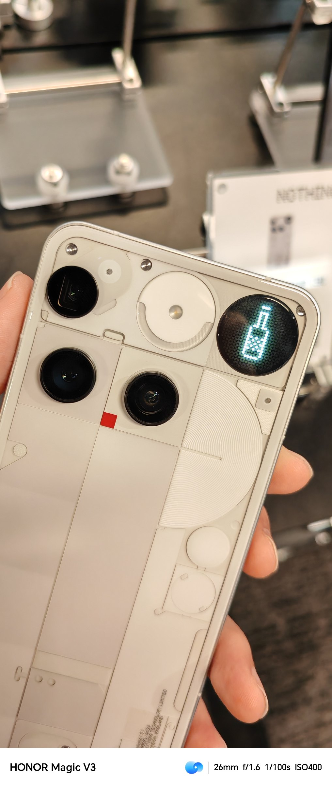
手に持ったときのエッジの立ち方と重量バランスの良さも印象的だった。派手なスペック競争や巨大なカメラユニットで威圧するのではなく、「触っていて気持ちがいい道具」としての美学を追求しているのが伝わってくる。こうしたデザインコンシャスな端末と、水冷ギラギラのゲーミングスマホが同じテーブルに並んでいるカオスさこそが、&countの真骨頂だ。

#### 4\. 伝説の始祖「Royole FlexPai」との衝撃の再会

そして、展示コーナーの一角で思わず二度見し、変な声が出そうになったのが「Royole FlexPai」である。
2018年秋、「世界初の市販折りたたみスマートフォン」**として世に送り出された伝説の初代機である。しかも、画面を内側に折りたたむ「インフォールド」ではなく、ディスプレイを外側に露出させたまま折り曲げる**「アウトフォールド（外折り）方式」を採用した、まさに折りたたみスマホの始祖だ。
私自身、外折りスマホであるHUAWEI Mate Xs 2を愛用している身として、その源流であるRoyole FlexPaiの実機を2026年の今、渋谷のど真ん中で触れるというのは感動以外の何物でもない。実際に手に取って開閉してみると、現代の薄型フォルダブル機とはまったく異なる、無骨で分厚いゴムと金属の塊のような感触がある。ヒンジ部分の柔軟なOLEDパネルのうねり方、閉じたときに決してフラットにはならず隙間が空くあの独特なフォルム、そして強引に画面分割して無理やり動かしているような初期UIの荒削りさ——そのすべてが、「人類が初めてスマートフォンを折り曲げようとした瞬間の熱量」を生々しく伝えている。
このような歴史的遺産とも言える実機が稼働状態で保存され、来場者が自由に触れる状態で置かれていることに、驚きを隠せない。

## 携帯電話研究家・山根康宏博士と遭遇。

文字通り**山根康宏博士**である。
海外モバイル業界の第一人者であり、世界中の展示会（MWCやIFAなど）や深圳の電脳街、香港の深水埗を駆け巡り、これまでレビュー・所有してきた携帯電話・スマートフォンは数千台にのぼると言われている、まさに「生ける伝説」だ。
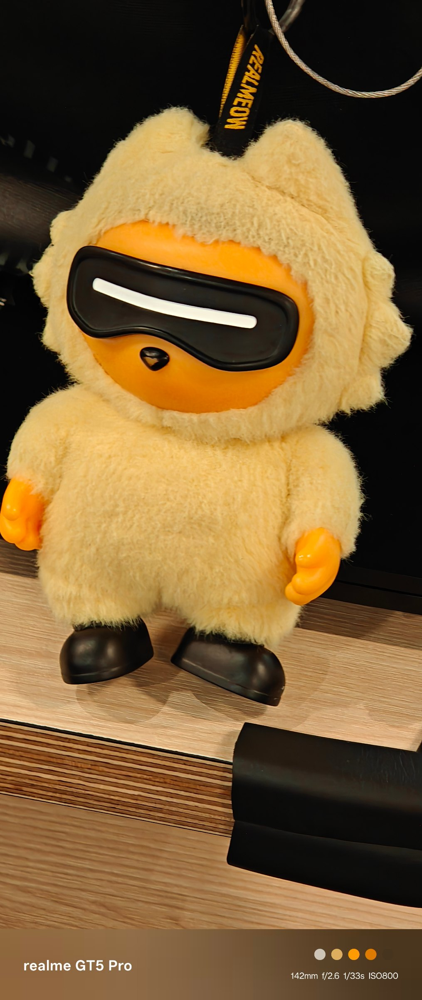
山根博士のバッグに必ずついているrealmeow（真奇喵）。

普段はITmedia Mobileやケータイ Watchなどの記事、あるいはSNSを通じてその発信を追いかけている雲の上の存在である。そんな山根博士が目の前にいらっしゃり、あろうことか**対面でお話しさせていただける**という夢のような展開が訪れたのだ。
最初は緊張で言葉が詰まりそうになったが、山根博士は驚くほど気さくだったが、緊張のあまり会話の内容をあまり覚えていない。すみません(笑)
そして会話が盛り上がる中、山根博士がニコリと笑いながらバッグから取り出してくださった端末を見て、私の心臓は跳ね上がった。「せっかくですから、これも触ってみますか？」と差し出されたのは、当時発表されたばかりの超最新・超話題の変態フラッグシップ機たちだったのである。

### 博士の私物について

山根博士のご厚意により、日本国内ではまずお目にかかれない2026年秋時点での最新鋭中国版フラッグシップを、実際に手に取って操作させていただくという神展開となった。

### 1\. 「横型ワイド」という新発明——Xiaomi 18 Fold

まず触らせていただいたのが、2026年9月に発表されたばかりの「Xiaomi 18 Fold」である。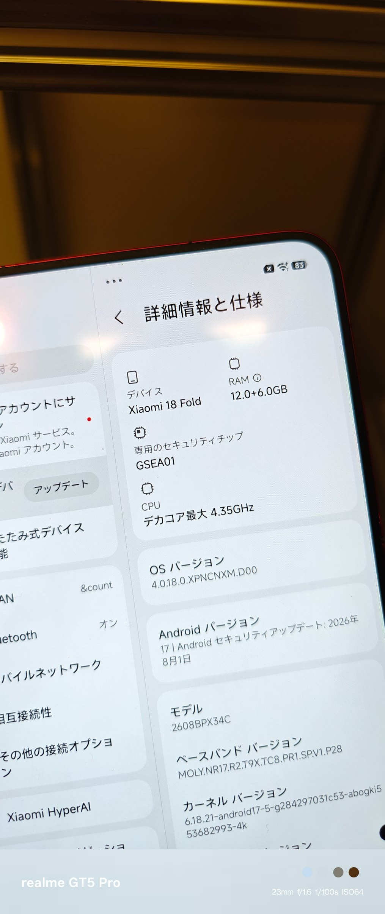
デカコア Xring O3を搭載する正真正銘のフラッグシップである。

これまでの横折り型フォルダブルスマホといえば、閉じた状態では縦長の通常のスマホ（アスペクト比20:9前後）で、開くとほぼ正方形（1:1に近い比率）のタブレットになる、というのが業界の常識だった。しかし、Xiaomi 18 Foldはその常識を根底から覆す「横型ワイド（パスポートサイズ／約4:3アスペクト比）」を採用したトレンドモデルだ。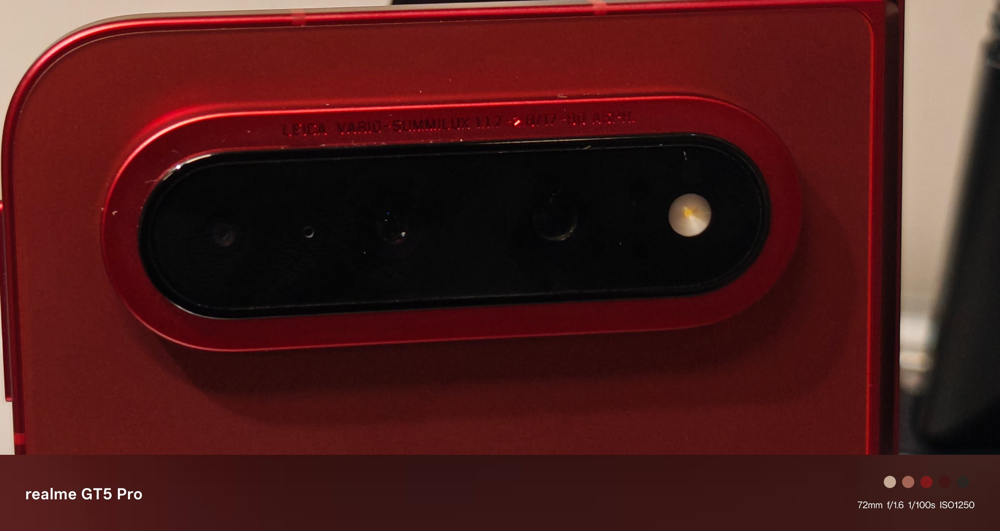
実際に手に取って閉じた状態を見てみると、まずその独特のフォルムに驚かされる。閉じたときのカバーディスプレイは5.38インチ（解像度1712×1168ピクセル）で、本体サイズは約117.8mm × 83.6mm、厚さ10.68mm。かつての初代OPPO Find Nをさらに洗練させたような、横幅が広く背が低いコンパクトな比率だ。これだけでも片手でのホールド感が抜群に良く、親指が画面の端から端までストレスなく届く。
そして、ヒンジを開いた瞬間に真価が発揮される。開いたときのメインディスプレイは**7.58インチ**、本体サイズは約117.8mm × 163.8mm、厚さはわずか**8.36mm**、重量は**約219g**という驚異的な軽さだ。この「約4:3」という横長ワイドな画面比率が、使ってみるとかなりいい感じだ。さらに、マルチタスクで最大3つのアプリを縦に並べて表示した際も、それぞれのウィンドウに十分な横幅が確保されるため、実用性が段違いだ。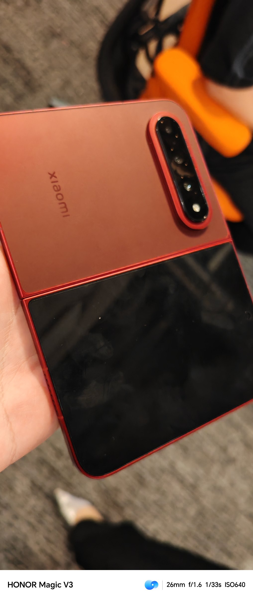外装はこんな感じ
それでいて内部には**6,000mAhバッテリー**を詰め込み、有線67W・無線50Wの急速充電に対応している。最近の中華にしては一般的なスペックである。
山根博士と「この4:3ワイド比率こそ、横折りスマホが本来辿り着くべき正解の形ではないかな、でもなあ、やっぱりHuaweiなんだよね(笑)。Pura Xあたりを買い直そうかな」と語っていたのが印象的だった。

### 2\. スマホの概念を破壊する機械生命体——HONOR Robot Phone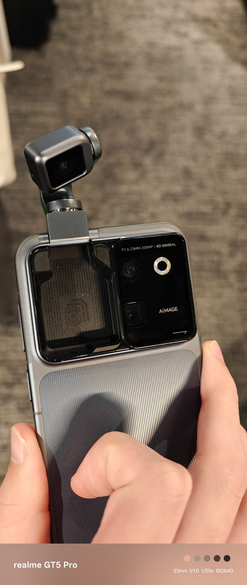**かわいい**

そして、この日最大の衝撃であり、まさに「神だった」と叫びたくなる体験をもたらしてくれたのが、2026年8月に中国で発売されたばかりの超問題作「HONOR Robot Phone」である。
2026年3月のMWC 2026でコンセプトが初公開され世界中のガジェット好きを騒然とさせたこの端末が、ついに製品版として目の前に現れたのだ。一見すると、6.31インチのLTPO OLEDディスプレイ（ピーク輝度6,800ニト、1〜120Hz可変）を備えた、少し厚みのある（厚さ約9.59mm、重量約248g）コンパクト寄りのフラッグシップスマホに見える。だが、その背面カメラユニットには、人類のスマートフォン史において類を見ない狂気の機構が格納されている。
それが、100以上の精密部品と100件以上の特許技術を結集して作られた超小型4自由度（4-DoF）メカニカルシステム「HONOR Titanium Agile Gimbal」だ。
山根博士に操作方法教わりながら起動させると、本体背面からチタン合金製のロボットアーム（フリップモーター駆動）が「ウィーン……」という精密機械特有の心地よい駆動音とともに展開し、カメラモジュールが文字通り「首を持ち上げて」周囲を見渡し始めたのである。
この瞬間、鳥肌が立った。従来の光学式手ブレ補正（OIS）やジンバルカメラ（かつてのvivo X50 Pro/X70 Pro+のマイクロジンバルなど）は、あくまでレンズやセンサーが数ミリ単位で微動する仕組みだった。しかし、HONOR Robot Phoneは違う。**カメラヘッドそのものが独立したロボットアームの先端に載っており、パン・チルト・ロール・フリップの4軸で物理的に大きく動く**のだ。重量わずか2.6gの「Titanium Gimbal Motor」は最大360°/秒という猛烈な制御速度を誇り、端末を左右に振っても、カメラのレンズはまるで生き物のようにピタリとこちらを見つめ続ける。
さらに恐ろしいのが、このカメラに載っているイメージング性能だ。メインの2億画素ジンバルカメラ（1/1.28インチセンサー、F1.6）は、あのシネマカメラの最高峰ブランド「ARRI」**とのパートナーシップ（ARRI Image Science）を実現しており、スマホでありながら**10-bit ARRI LogC3収録**やARRI Wide Gamut 3、DaVinci Resolveで直接適用できるARRI LUTにまで対応している。それに加えて、光学2.7倍の2億画素ペリスコープ望遠（1/1.4インチセンサー）と5000万画素の超広角カメラまで搭載し、内部にはSnapdragon 8 Elite Gen 5と**7,060mAhという化け物じみた大容量バッテリー（120W有線・50W無線充電対応）を内蔵している。
さらに「YOYO Robot Mode」を起動すると、AIによる被写体認識（AI Subject Tracking）と音源位置検出が連動し、テーブルの上にスマホを置いておくだけで、カメラアームが自律的に動いて喋っている人間の方向を向き、ジェスチャー操作だけでアームが展開・収納される。もはやこれは「カメラが付いたスマートフォン」ではない。「ディスプレイと通信機能を備えた小型自律撮影ロボット」である。山根博士の目の前で、手のひらを動かしてカメラアームを追従させながら、「中国メーカーのハードウェア開発力は、ついに物理的なロボティクスの領域まで突破してしまったのか」と深い感動と興奮に震えた。

## 3\. 幻の三つ折り怪獣——Samsung Galaxy Z TriFold

​さらに忘れてはならないのが、山根博士に見せていただいたもう一台の超弩級端末、「Samsung Galaxy Z TriFold」である。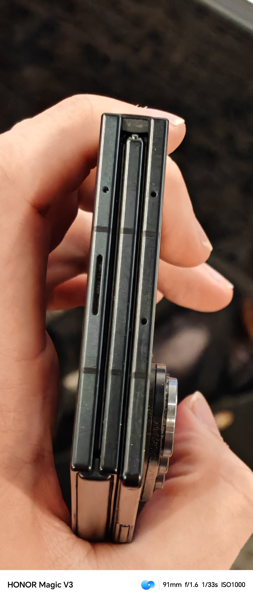おお笑
​2025年12月に韓国などで発売され、米国でも2026年1月末に即完売したものの、わずか3ヶ月後の2026年3月には生産終了（ディスコン）が発表されたという、まさに「幻の初代三つ折り機」だ。日本未発売かつ既に市場から姿を消したこのレア端末を、博士のコレクションから直接拝めるというのは僥倖としか言いようがない。
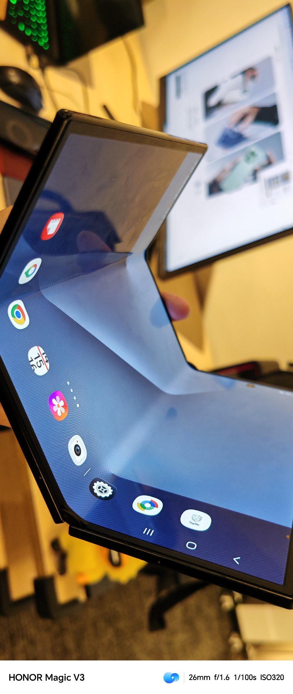​HUAWEI Mate XTが画面をZ字型（内折り＋外折り）に折りたたむのに対し、Galaxy Z TriFoldは左右のパネルを両方とも内側に折り込む「G字型（デュアルインフォールド）構造」を採用している（Mate XT2も同様の形状）。
そのため、閉じた状態ではフレキシブルディスプレイが完全に内部に保護され、背面側にある独立した6.5インチのカバーディスプレイ（2520×1080、アスペクト比21:9）を普通のスマホのように使えるのが特徴だ。
実際に畳んだ状態で握ってみると、厚さ12.9mm・重量309gというずっしりとした「金属とガラスの塊感」があり、通常のスマホとは一線を画す重厚な存在感を放っている。そして、左パネル・右パネルの順に画面をを開放した瞬間、目の前に出現するのが10.0インチ（2160×1584、4:3比率）の巨大なAMOLEDディスプレイだ。広げた状態での厚さはパネルごとに3.9mm〜4.2mmという驚異的な薄さで、309gという重量が一気に広大な面積へ分散されるため、手に持った瞬間に「うわ、軽い！」と錯覚するほどバランスが良い。面白いのが折りたたみ時のギミックで、右側のパネルから先に閉じようとすると本体が振動して「折り方が違う」と警告してくれる保護機能まで備わっている。2億画素のメインカメラにSnapdragon 8 Elite for Galaxy、5,600mAhの3セル分散バッテリー、さらには単体でデスクトップ環境が立ち上がるSamsung DeXまで詰め込んだ、まさにSamsungの技術力の誇示とも言える一台。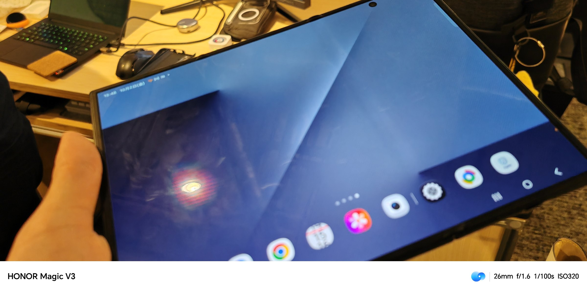ﾝｱｰｯ!!（画面が）デカすぎます!!
わずか数ヶ月で短命に終わったからこそ、その狂気的なヒンジ機構と10インチ画面の迫力を実機で体感できたのは、間違いなくこの日一番の贅沢の一つだった。

### まとめ——「触れる場所」があることの幸福

気がつけば、予約していた時間はあっという間にオーバーしていた。
2026年10月2日という日は、私にとって間違いなく忘れられない記念日となった。
「&count」そこには、REDMAGIC 11 Proや鳴潮コラボモデル、Astra 2、Nothing Phone (3)、そして始祖Royole FlexPaiといった新旧の変態・最新ガジェットが惜しげもなく並べられ、誰でも無料で手に取ってその質感を確かめることができる。
そして何より、その場所で日本のモバイル界のレジェンドである山根康宏博士と1対1でお話しし、Xiaomi 18 Foldの革新的な4:3ワイド体験や、HONOR Robot Phoneの4軸チタンジンバルが生き物のように動く衝撃をリアルに体感できたことは、スペック表を眺めているだけでは一生味わえない至上の喜びだった。
スマートフォンの進化は頭打ちだ、どれも同じ板切れになった、と世間ではよく言われる。だが、世界にはまだこれほどまでに狂気とロマンに満ちたハードウェアが生み出され続けている。そして、それらと直接「エンカウント」できる場所が、ここ東京・渋谷に確かに存在するのだ。次にまたどんな未知のガジェットが&countの棚に並ぶのか、そしてまたあの濃密な空間でどんな出会いがあるのか——
