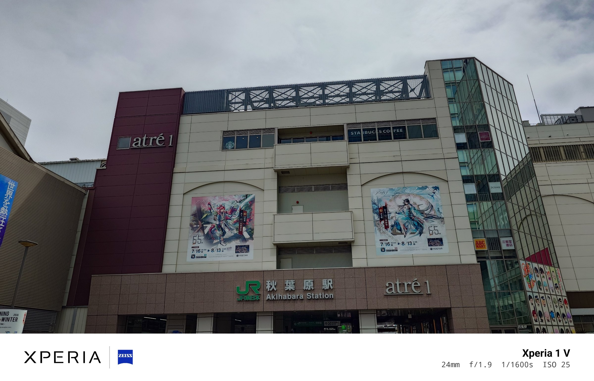
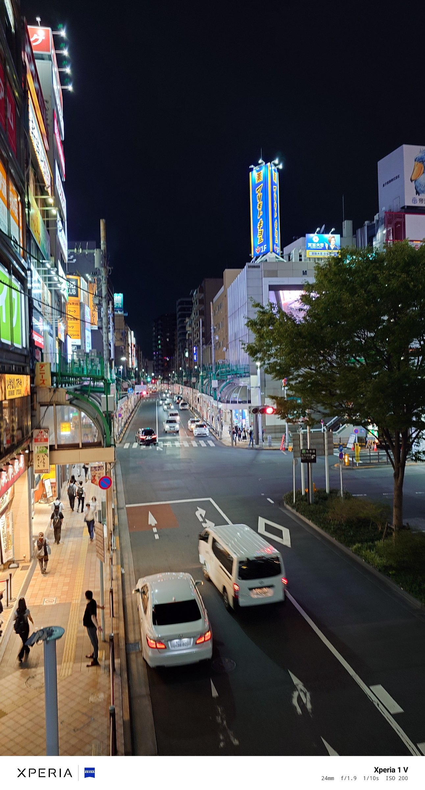
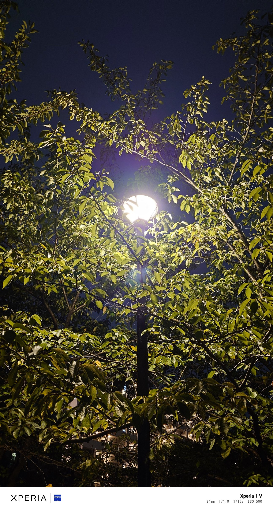
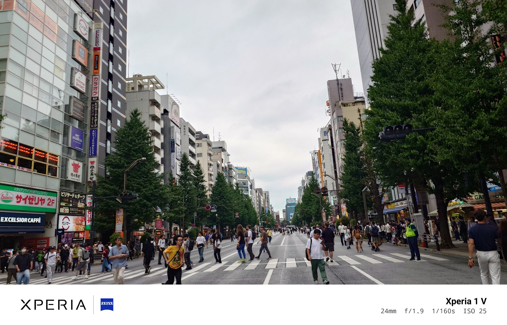
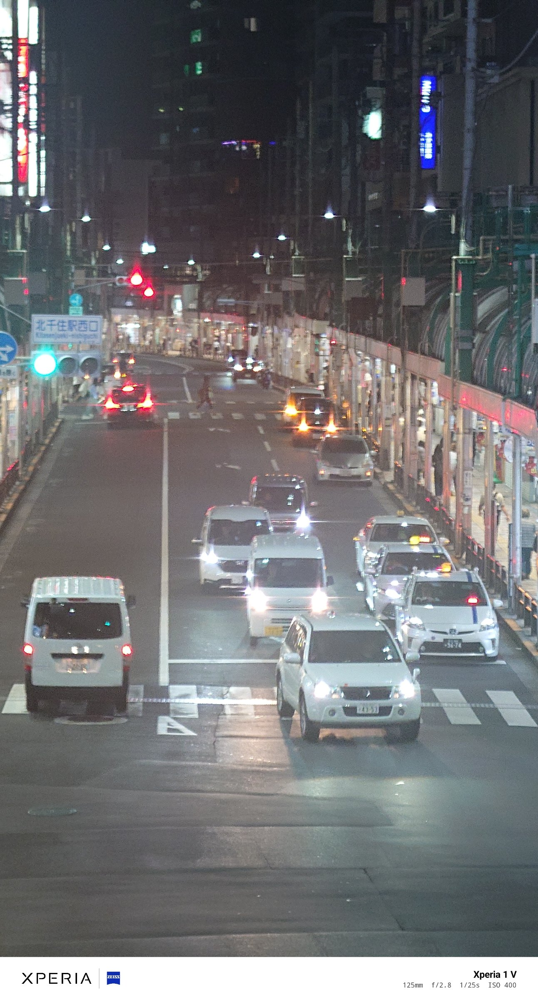
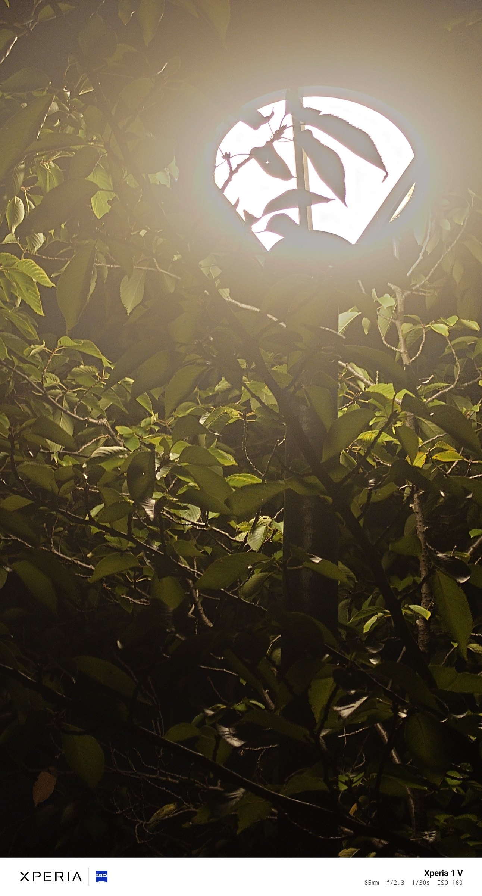
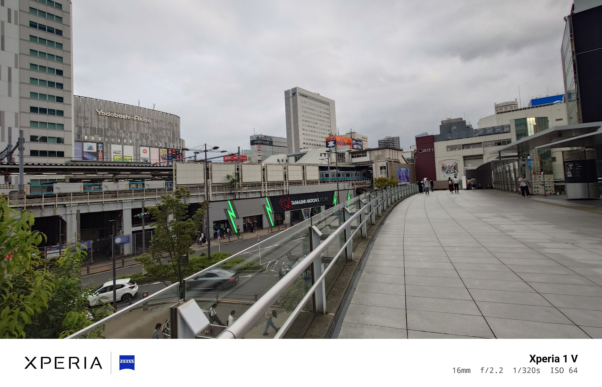
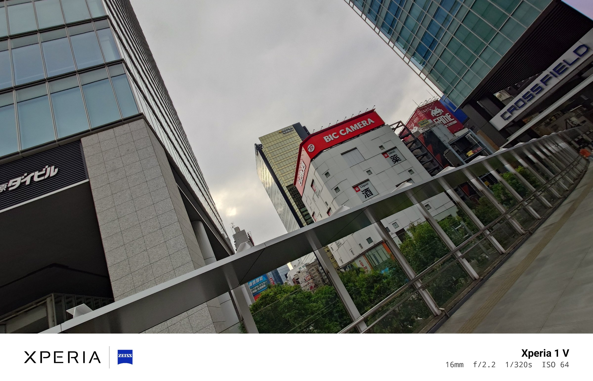

スマートフォンがどれも同じようなデザイン、同じような機能に収束していく現代において、ソニーの「Xperia 1 V」は明らかに国産スマホとしては異端であった。

トレンドに迎合することなく、\|己《Sony》の哲学を貫き通したその姿は、刺さる人にはとことん刺さり、そうでない者には理解不能な代物かもしれない。

結論から言おう。この端末は、エンターテインメントとクリエイティビティ、そして日常使いにおいては\|「神」《Xperia》であり、日頃中華スマホを使っている筆者からすると、ありとあらゆる面で「ありえないほどの不満」を抱える、極端に尖ったスマートフォンである。

本記事では、Xperia 1 Vのスペックを総ざらいしつつ、筆者が実際に使い込んで感じた「絶賛」と「絶望」を包み隠さず語り尽くす。
妥協なき変態仕様。Xperia 1 V フルスペック
まずは、この尖りまくったマシンの全貌を把握してほしい。現代のハイエンドとして恥じない、いや、一部においては他を凌駕するスペックを誇っている。

### スペック項目

筆者が今回レビューしたのは\|docomo《クソゴミ》版\(12/256\)となる。

SoC:Qualcomm Snapdragon 8 Gen 2
RAM:12GB / 16GB (SIMフリーモデル)
ストレージ:256GB / 512GB (SIMフリーモデル)
外部ストレージmicroSDXC対応 (最大1TB)
ディスプレイ:6.5インチ 4K (3840×1644)21:9 有機ELディスプレイ
リフレッシュレート:120Hz(GameEnhancer利用で最大240FPS)
アウトカメラ (広角)有効約4800万画素 (記録約1200万画素) 24mm / F1.91/1.35型 Exmor T for mobile
アウトカメラ (超広角)約1200万画素16mm / F2.21/2.5型
アウトカメラ (望遠)約1200万画素85mm-125mm (可変ズーム) / F2.3-F2.81/3.5型
インカメラ約1200万画素24mm / F2.0 1/2.9型
バッテリー容量5000mAh
オーディオ:3.5mmオーディオジャックフルステージステレオスピーカーハイレゾ対応
生体認証:電源ボタン一体型指紋認証のみ
防塵防水IP65 / IP68
サイズ/重量:約165 × 71 × 8.3 mm / 約187g

意外とカメラが不満だった。
Sonyといえばカメラ。Xperiaといえばカメラ。XperiaといえばZeiss。誰もがそう期待するだろう。しかし、静止画撮影に関して言えば、マジでありえないくらい不満である。
まず、メインとなる広角レンズだ。新開発のセンサー「Exmor T for mobile」を搭載し、暗所性能が劇的に向上したと謳っているが、光源に対する耐性がかなり弱い。夜景や強い光源を撮影すると、光がブワッと盛大に光の乱反射や白飛びとして写り込んでしまうのだ。空の色が白く飛んでしまっていることがわかる。
あり得ない。これが本当に二層トランジスタ構造なのか？せっかくのZeissの解像感が台無しになるこの現象は、19万円もするフラッグシップ機として到底許容できるものではない。
次に望遠レンズ。85-125mmの光学可変ズームというロマン溢れる機構を搭載しているのだが、この可変絞りの機構的特性のせいか、描写が全体的にモヤッとしており、かなり曇ったような写りに仕上がってしまう。シャープさや抜け感が決定的に欠けており、記録用としてはともかく、作品作りには厳しいと言わざるを得ない。完全に白飛びしてしまっていることがわかる。
だが、ここで意外な伏兵が存在する。超広角レンズだ。昨今のスマートフォンの超広角は0.5倍や0.6倍と極端に広い画角を持つものが多い中、Xperia 1 Vの超広角は16mm（約0.7倍相当）と、少しだけ画角が狭い。しかし、これが逆に功を奏している。極端な広角レンズ特有の魚眼的な不自然な歪みが抑えられており、非常に素直で扱いやすい。構図がバシッと決まり、純粋に「楽しく撮れる」カメラに仕上がっているのは、数少ない救いである。もちろんグレアが出まくるのでそもそも論、カメラ自体がクソであることは間違いない。

狂気の沙汰。他を圧倒する「動画性能」

カメラで撮影した静止画への不満を長々と語ったが、それを補って余りある……いや、それを完全にねじ伏せるほどのバケモノじみた性能が「動画」である。
Xperia 1 Vの動画性能は、ホンマに凄い。なにせ、搭載されている全てのアウトカメラ（超広角・広角・望遠）で4K 120fpsの動画撮影が可能なのだ。こんな頭のおかしい（褒め言葉）仕様のスマートフォンは、この世にXperiaしか存在しない。他社のスマホでは「メインレンズのみ4K 60fps対応、他は1080p」といった制限が当たり前だが、Xperia 1 Vはどの画角からでもシネマティックで滑らかな超高画質スローモーション素材を錬成できる。ビデオグラファーにとって、これほど頼もしいポケットサイズのシネマカメラは他にないだろう。もちろん、そもそものカメラ性能が終わっているので、全然綺麗には撮れないが、面白い機能ではある。
ちなみに余談だがSnapDragon8Gen2のため性能はバッチリである。

視覚と聴覚を支配する、至高のディスプレイとスピーカー

エンタメ体験において、Xperia 1 Vの右に出る機体はそう多くない。まず、21:9の比率を持つ4K有機EL（シネマディスプレイ）は、映画コンテンツを視聴する上でマジで最高である。上下に黒帯が出ることなく、画面いっぱいに広がる超高精細な映像は、スマートフォンであることを忘れさせるほどの没入感をもたらす。そして、特筆すべきは内蔵スピーカーの音響である。他の中華スマホなどに見られる傾向として、Honorのように低音をブワブワと響かせて気持ちよくさせるチューニングや、昔のXiaomiのようなHarman/Kardon監修のダイナミックで派手なサウンドがある。それらも決して悪くはない。 しかし、Xperia 1 Vのサウンドは全くの別物だ。低音から高音まで、本当に「音の粒」が美しく整頓されており、極めてクリアで解像度が高いサウンドが飛び出してくる。ボーカルの息遣いや楽器の繊細な震えまで正確に描写するこのスピーカーは、凄まじい完成度である。

伝統の継承と拡張性

最近のスマートフォンが次々と切り捨ててきたものを、Xperia 1 Vは頑なに守り抜いている。

各社ハイエンドスマホのストレージは肥大化し、端末だけで完結する中で、Xperiaは最大1TBまで対応するSDカードスロットを搭載(写真や音楽のみの保存にのみ対応している。ちなみにSpotifyもSDカードダウンロードに対応している)。

そして、完全ワイヤレスイヤホン全盛期にあって、ハイレゾ対応の3.5mmオーディオジャックをしっかり備えている。これは単なるレトロフィットではなく、高音質を追求するWALKMANの意匠と哲学が、スマートフォンという形を借りて確実に継承されている証拠である。さらに、これだけのスペックと機能を詰め込みながら、横幅はわずか71mm。非常に細身に作られており、誰でも片手でガッチリとホールドできる絶妙なサイズ感を実現している。そして最後になるが、筆者はこの愛すべき変態端末のポテンシャルをさらに引き出すため、Xperiaで使える専用のアプリ(透かし自動合成を2種類、スクリーンセーバー)まで自ら開発してしまった。これほどまでにユーザーのクリエイティビティ（と、少しの狂気(？)）を刺激し、何かを作らせてしまう魔力が、このスマートフォンには宿っているのである。

総評

Xperia 1 Vは、決して万人受けする優等生ではない。

広角のグレアや望遠の曇りなど、スチルカメラには致命的とも言える弱点を抱えている。しかし、全レンズ対応の4K 120fps動画撮影、比類なき4K 21:9ディスプレイ、極めて解像度の高い美しいスピーカーサウンド、そしてSDカードとイヤホンジャックの搭載。これら特定の分野においては、他の追随を許さない圧倒的な輝きを放っている。欠点には目をつぶり、強烈な個性と長所を愛せるか。もしあなたが音と映像の極致をポケットに入れて持ち運びたいと願うなら、Xperia 1 Vは良い選択肢の候補の一つになるだろうが、正直筆者はあまりおすすめはしない。4Kシネマディスプレイの影響でバッテリー持ちは大して良くない上に、純正Androidの使いにくいところがかなり顕著に出ているのも感じるのは事実だ。

絶対に
