ということで
今回レビューしていくスマホは
そもそも日本はおろか、中国ですら
キャリアのオフライン店舗でしか発売されず
中国国内ですらそこまで流通しなかったという
噂もあるほど見かけない激レアスマホ、
Honor X50 Proである。
大陸版しか存在しないため、表記はもちろん中国名である。
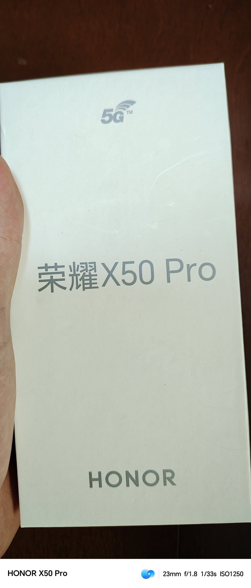
↑かなり興奮するシンプルな外箱。こういうのでいいんだよ。

スマートフォン市場が
コモディティ化の極みに達し、
どのメーカーも似たような大型カメラ島と、
バッテリー持ちを取るか
薄さを取るかの妥協を強いられていた時代。

その常識を真正面から粉砕した
一台のスマートフォンが存在する。
それが、Honor X50 Proだ。
2026年現在においても、この端末が放つ異彩は色あせるどころか、より一層際立っているような気もする（笑）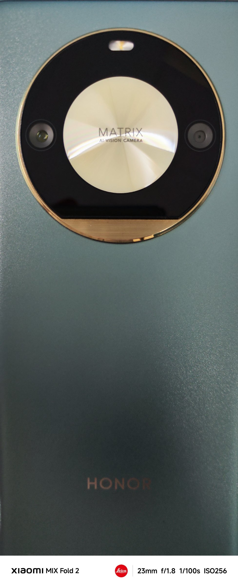
↑見た目はさながらHuaweiのMateシリーズの上位互換のようだ。

## そもそもHonorって何？

ガジェヲタはスキップして、どうぞ。

もともとは中国最大手の巨大通信機器メーカーHUAWEIの若者向け低価格サブブランドとして誕生した。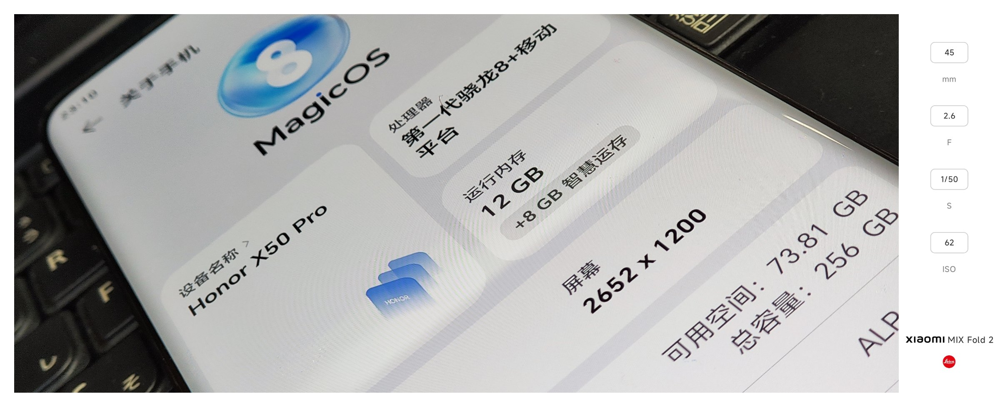
↑MagicOS 8を搭載している。

### アメリカの制裁を逃れるための独立

数年前、親会社であるHUAWEIがアメリカの制裁を受けた際、HUAWEIと同じ扱いを受けてスマホ事業が潰れるのを防ぐため、Honorは2020年末にHUAWEIから完全に別の会社として売却・独立した。
こうしてHUAWEIから離れたことで、アメリカの制裁対象から外れることに成功した。
これにより、Googleのサービス（Google Playストア、YouTube、Googleマップなど、いわゆるGMSというやつだ）が最初から普通に使えるようになり、ハードウェアのパーツもアメリカ製のもの（SnapDragonやDimensity）が自由に調達できるようになった。

現在では
「安さ重視の格安ブランド」から脱却し、かつての親会社であるHUAWEI譲りの高い技術力を活かした高級・高性能ブランドとしてHonorは世界中で展開されている。

***

さて、本編に入る。
結論から言おう。

これは、2026年で見渡してもあまり類を見ない
バッテリーの大きさ
薄さ
エレガントさを
極限の次元で兼ね備えた
**マジモンの化け物マシーンである。**

カタログスペックの数字を見ただけでは
信じられない、持った瞬間に「マジかよ」と声が漏れる魔力が、この筐体には詰まっている。
これがHonor Magicである（違う）。

## Honor X50 Pro スペック

* **ディスプレイ**: 6.78インチ AMOLED、120Hzリフレッシュレート、1.5K解像度（2652×1200）、曲面エッジディスプレイ
* **メモリ・ストレージ**: 12GB RAM / 256GB ROM（Honor X50 GTでは16/1TBまで用意されていたが、X50 Proは販路が限られていたため、12/256の一つである。しかし、この12/256編成が当時のXシリーズで出るのは極めて異例だ）
* **生体認証**: 画面内指紋認証、顔認証（どちらもMagicOS由来の高速さを誇る）
* **OS**: MagicOS 7→8（販路が極めて限られていたため、アプデが来ない）
* **技適**: もちろん中国大陸限定モデルなので通っているわけが無い。最高だ。筆者の大好物、技適なしスマートフォンである。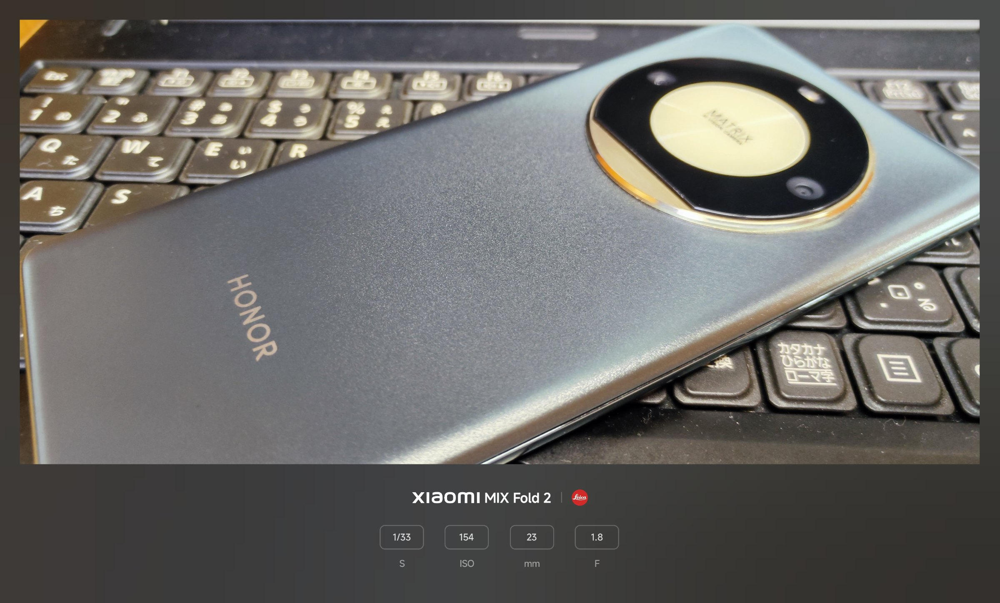

## Honor X50 Proがスマホ市場に投げかけたモノ。

Honor X50 Proの圧倒的な「佇まい」と「実用性」を語る上で、どうしても外せない、そして語るべき最大のキモがある。
それが、「Honor Xシリーズ」というラインナップにおける、この端末の特異な立ち位置だ。

当時のスマートフォン市場を思い出してほしい。各社がこぞって「Snapdragon 8 Gen 2」や「Snapdragon 8 Gen 3」といった最新鋭のハイエンドチップを搭載し、価格も右肩上がりに高騰していく感じであった。
そんな狂熱の最中、HonorがこのX50 Proで打った戦略は、市場の度肝を抜くものだった。

## 「あえての型落ち」がもたらした、圧倒的という名の正義

通常、Xシリーズといえば、Honorのラインナップの中では「ミドルレンジ〜アッパーミドル」を担う、いわば実用性とコスパを重視したクラスである。フラッグシップはあくまで「Magicシリーズ」の専売特許だった。

しかし、HonorはこのX50 Proにおいて、その常識の垣根を軽々とぶち壊してきた。
あえて最新のGen 2やGen 3ではなく、世代を一つ落とした「Snapdragon 8+ Gen 1」を準ハイエンドとして採用したのだ。 これが本当に素晴らしい。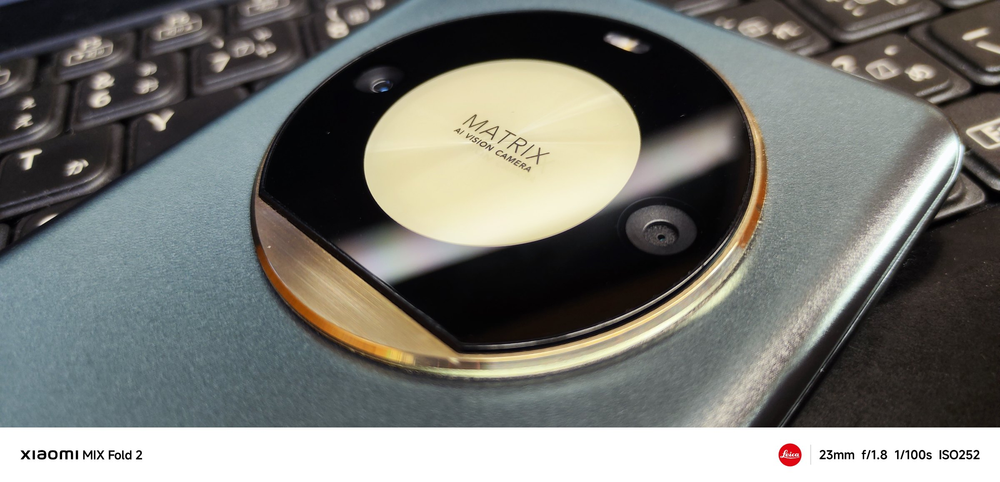

当時の型落ちハイエンドチップは確かに最高性能を叩き出す一方で、初期のSnapdragon 8 Gen 1が抱えていた悪夢のような発熱問題のトラウマや、バッテリー持ちの悪さという大きなジレンマを抱えていた。
そこでHonor X50 Proに選んだ「Snapdragon 8+ Gen 1」は、SamsungファブからTSMCファブへと製造プロセスが移行し、劇的な発熱軽減と電力効率の改善を果たした「歴史的名機」である。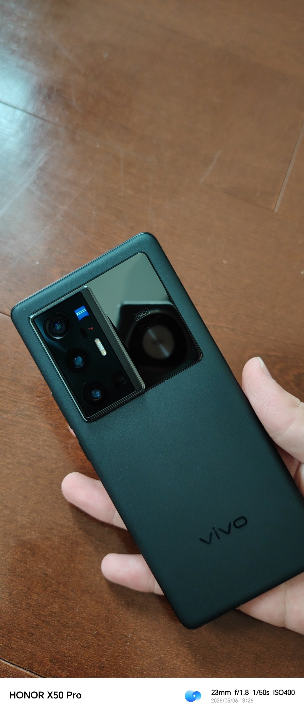
↑爆熱マシーンの一つ、SnapDragon888+ (vivo X70 Pro Plus)

メーカー側としてはコストを大幅に抑えつつ、ユーザー側としては「実質的に最高峰のゲーム性能とサクサク感」を、最新フラッグシップの半額近い、圧倒的なコストパフォーマンスで手に入れられる。
「最新の数字遊び」に背を向け、ユーザーが本当に求めている「実用的な最高益ベストバランス」を冷徹に計算し尽くした上での采配。
この割り切りと戦略眼には、脱帽するほかない。

## 唯一無二の「TSMC製・Snapdragon 8シリーズ」という安心感

そして、ユーザー視点で何より胸が熱くなるのは、
「Xシリーズでありながら、心臓部にれっきとしたSnapdragon 8シリーズの血統、しかもTSMC製を宿している」という点だ。

ミドルレンジ機にありがちな、少し格下のSnapdragon 600番台やDimensityの廉価版を積んで「なんかワンテンポもたつくな…」といった妥協が、この端末には一切ない。

正真正銘、かつての最高峰フラッグシップを動かしていたエンジンが、あの薄型軽量の美しいボディにそのままブチ込まれているのだ。

2026年の現在から振り返っても、「これ以上のスペックが、日常のスマホライフに果たして必要なのか？」という問いに対する、一つの完成された答えがここにある。 他社が過剰スペックと価格高騰のチキンレースを繰り広げる中、HonorはX50 Proという「特異点」によって、賢いユーザーの心を完全に撃ち抜いた。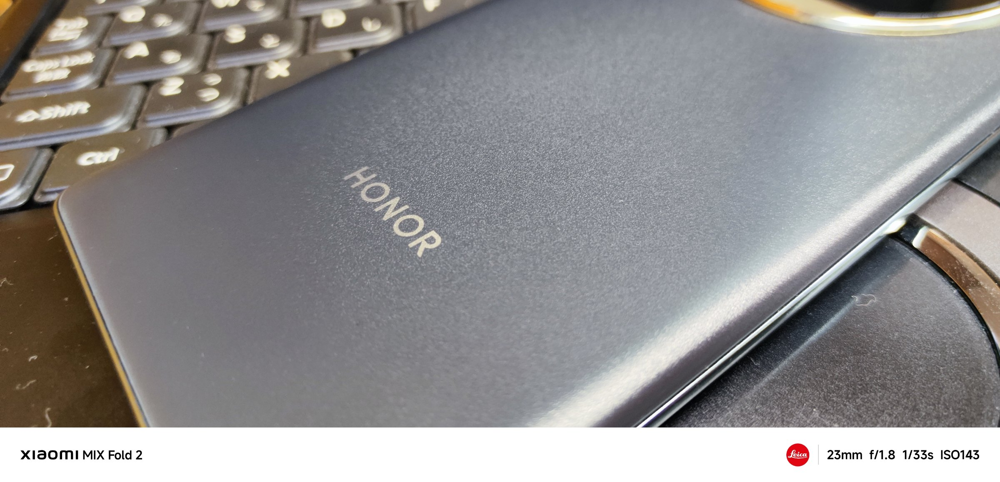
↑とにかく薄いことがわかるだろう。

## 誰もが度肝を抜かれる「5800mAh×厚さ約7.98mm」という物理的バグ

現代のスマートフォンにおいて、大容量バッテリーを搭載することと、筐体を薄く美しく仕上げることは、永遠のトレードオフだった。
Honor X50 Proが出た当時、5000mAhを超えるバッテリーを積もうものなら、本体は分厚くなり、ずっしりとする。これが常識だった。
しかし、Honor X50 Proはこの常識を物理的にハッキングしている。

筐体に内蔵されているバッテリー容量は、なんと**5800mAh**。同クラスのライバル機が5000mAh前後に留まる中、頭一つ抜けたモンスター級の容量を誇る。
それにもかかわらず、本体の厚みはわずか**約7.98mm**、重量は**192g**に抑えられている。

実際に手に持ったときの衝撃は筆舌に尽くしがたい。
「え、中に本当に5800mAhも入っているのか？」と疑うほどスリムで、両サイドにかけて美しくラウンドしたエッジディスプレイが手に吸い付くようにフィットする。
指先に食い込むような不快なエッジの角張りは一切なく、極上の滑らかさだけが残る。
大容量バッテリー機特有の「我慢して使う野暮ったさ」がミリ単位で排除されており、ジュエリーのような気品と、圧倒的な道具としてのタフネスが同居しているのだ。素晴らしい。

## HUAWEIの血脈：108MPカメラが織りなす「パキッと、クッソ綺麗な」、Magic。

スペック表の数字遊びに終始する昨今のミドルハイクラスにおいて、Honor X50 Proのカメラ構成は一見するとシンプルに見える。メインに据えられたのは10,080万画素（108MP）のメインセンサー1つだ。

あとはXシリーズのカメラバンプの象徴である、スカイリングデザインの対称性を保つために、深度センサーカメラ2MPが搭載されているが、実質単眼と考えていいだろう。
やはり、システムだけではなく、デザインといったところにも手を抜かないのは、流石Honorだ。

昨今流行りのトリプル・クアッドカメラではなく、あえて実用性を重視したデュアル構成（実質的には単眼主体の割り切り）である。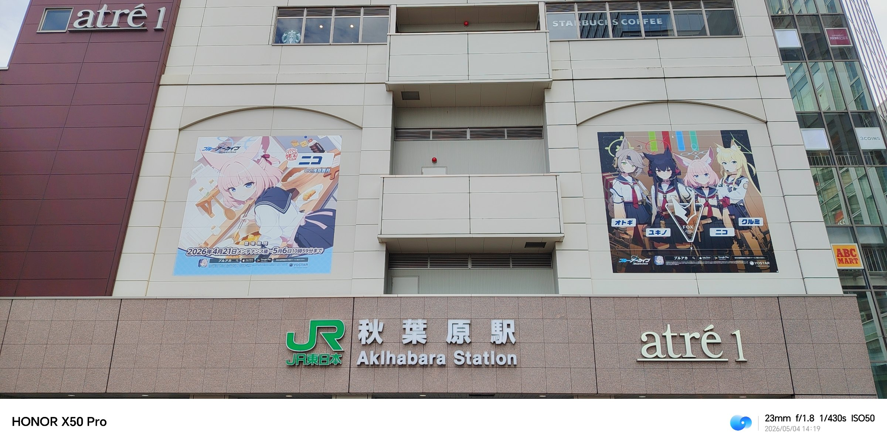
↑性能に関しては申し分ないどころか、かなりくっきり映る。

だが、ここでスマホカメラの奥深さを思い知らされる。 「画素数が高ければ綺麗」という単純な話ではない。HUAWEIから独立したHonorの真骨頂は、画像処理エンジン（ISP）のチューニング能力にある。かつてスマホカメラの歴史を塗り替えたHUAWEI直系の血脈が、この108MPセンサーを完全に支配している。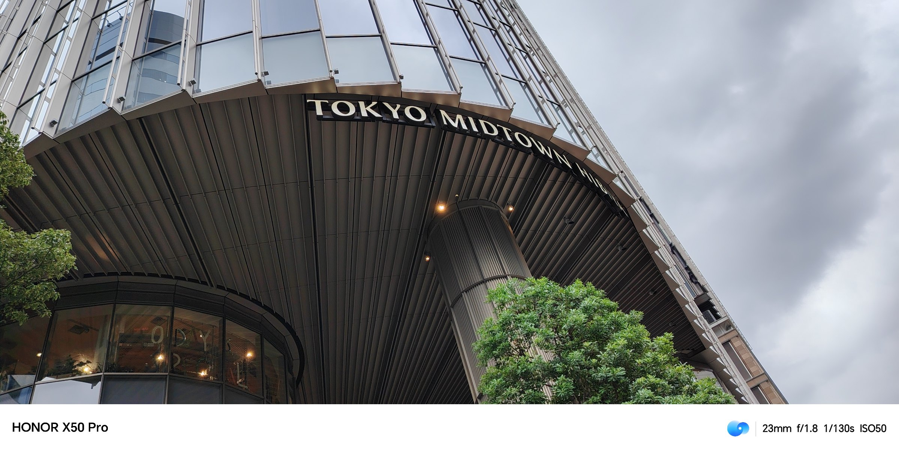
↑東京ミッドガーデン日比谷にお邪魔したときに撮影。

実際に撮影してみると、その写りに誰もが言葉を失う。
一般的なこのクラスのスマホによくある「眠い描写」や「白飛びしたハイライト」は綺麗に排除されており、シャッターを切った瞬間、ファインダー越しにパキッと、クッソ綺麗に景色が切り取られる。輪郭のシャープネスが絶妙で、かといって不自然な塗り絵感（過剰なAI補正）がなく、空気の冷たさや被写体の質感がダイレクトに伝わってくる。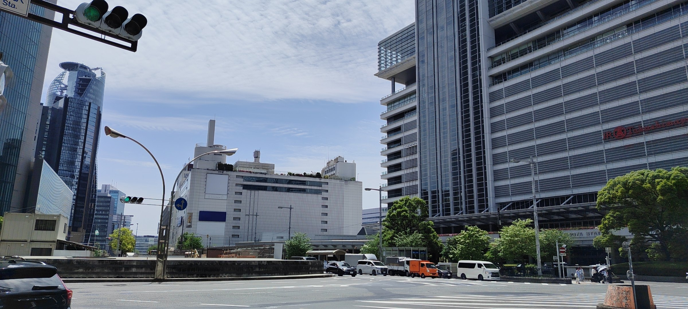
↑名古屋にて。

特に室内の複雑な光源下での写りは圧巻だ。
HUAWEI譲りの強力なマルチフレーム合成とISPのノイズ処理が完璧に噛み合い、ハイライトは白飛びさせずにねじ伏せているように感じる。
Samsung HM6のセンサーサイズ（1/1.67インチ）の物理的限界を超えたような、エッジの効いた「映える」絵作りがノーマルオートで吐き出される。すごいよこれ、と心の底から感嘆せざるを得ない実力だ。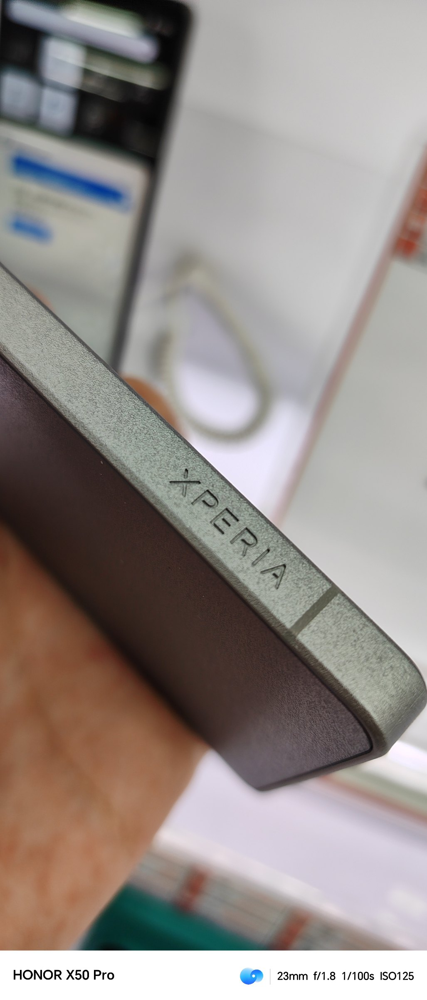
↑背景のボケ具合の良さには本当に言葉を失う。家電量販店などでの様々な方向からの光源も問題なくこなしている。

## 心臓部には「名機」の余裕：Snapdragon 8+ Gen 1の最適解

搭載するSoCは、QualcommのSnapdragon 8+ Gen 1。
2026年の基準から見れば一世代前のチップセットではあるが、これが絶妙なチョイスとなっている。発熱と電力効率のバランスに苦しんだ初期のSnapdragon 8 Gen 1から、TSMCのファブに移行して劇的な進化を遂げた「伝説の名機」だ。

最新の重い3Dゲームを最高設定で何時間も回し続けるといったウルトラハードな使い方をしない限り、日常のあらゆる動作は完全にヌルヌル、サクサクである。リフレッシュレート120Hzに対応した6.78インチの有機ELディスプレイ（解像度2652×1200）の滑らかさと相まって、画面スクロールやアプリの切り替えでストレスを感じる瞬間は一切ない。

何より、このSoCと5800mAhという大容量バッテリーの組み合わせが、驚異的な電池持ちをもたらしている。どれだけ動画を見ても、SNSを巡回しても、マップで道を迷いながら歩き回っても、一日が終わったときにバッテリー残量が50%を切らない安心感。モバイルバッテリーを持ち歩くという現代人の呪縛から完全に解放される快感を、この薄型ボディで実現している点が最大の価値なのだ。

画面内指紋認証の精度とスピードも非常に高く、触れた瞬間にロックが解除される。エッジディスプレイでありながら誤タッチが少ないことも、ソフトウェア側のチューニングの巧みさを物語っている。

## 総括：所有欲と実用性を極限で満たすマスターピース

Honor X50 Proは、派手なギミックや、誰も使わないマクロ・超広角の数を揃えただけの「なんちゃってハイスペック」とは一線を画す。

> 毎日使う相棒だからこそ、バッテリーは死ぬほど持ってほしい。でも、分厚くて重いのは絶対に嫌だ。そして、写真は一発で美しく、パキッと決まってほしい

そんな、わがままで本質的なユーザーの願いを、すべて高次元で形にしてしまった奇跡のような一台だ。

2026年の今、もしあなたが「本当に買ってよかった」と思える、心から愛せるスマートフォンを探しているなら、この異形の化け物マシーンは、今なお最強の選択肢の一つであり続ける。手に取った瞬間から、あなたのスマホ観を心地よく裏切り続けてくれるはずだ。

***

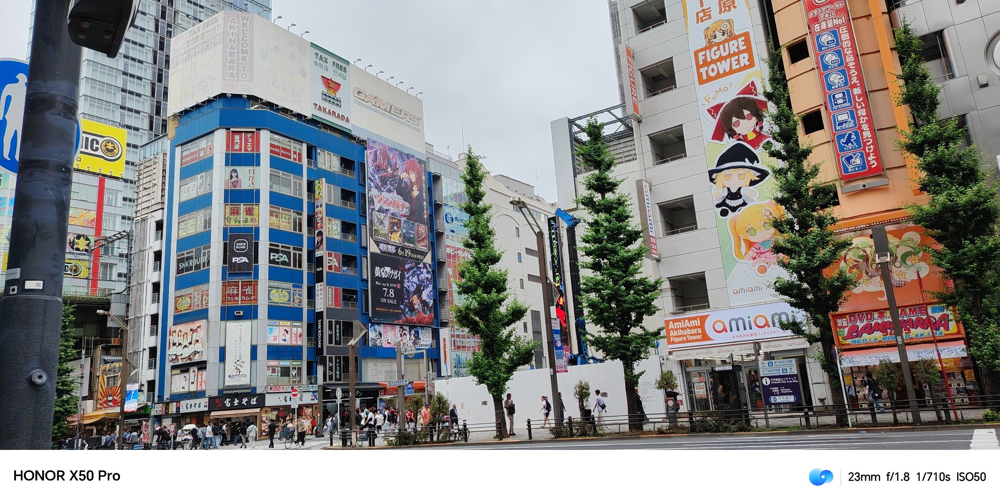
↑石丸電気解体時

ここまで見てくださり、ありがとうございました。
